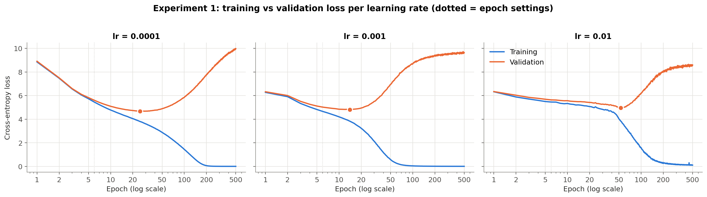
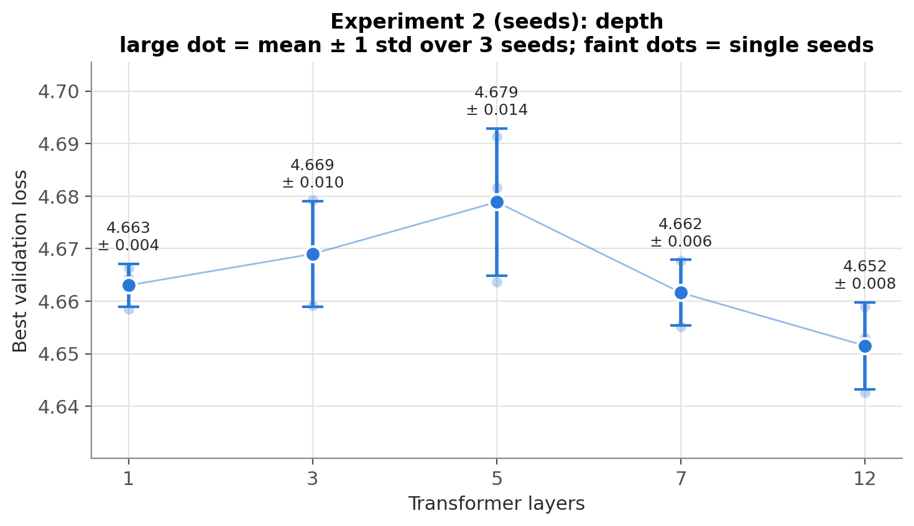
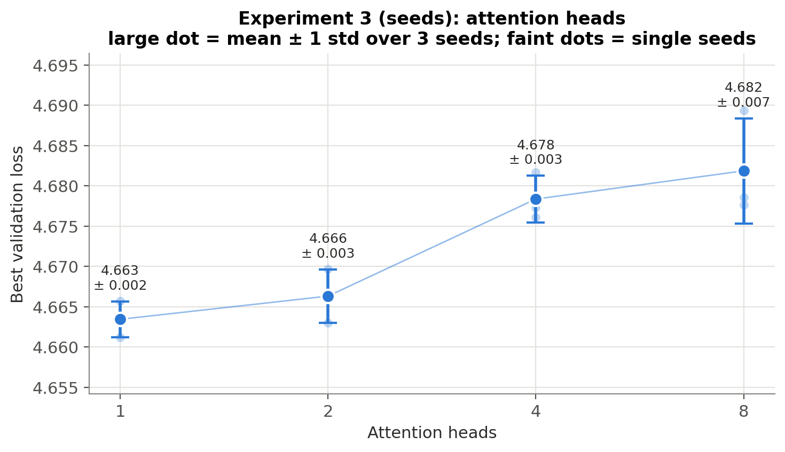
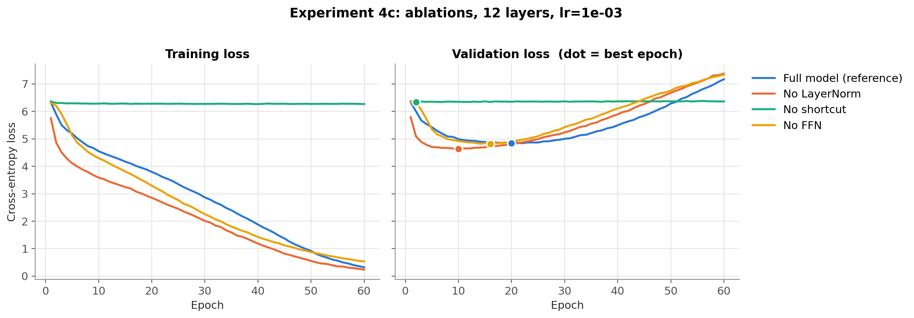
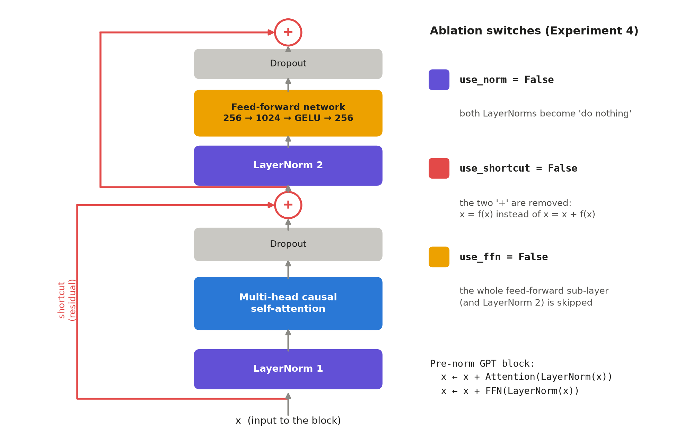

# Training a GPT-Style Language Model from Scratch

### Effects of Training Duration, Learning Rate, Depth, Attention Heads and Block Components

[](https://colab.research.google.com/drive/1zfz-atgfb0Z72t7IwxTM5HA-_C3_LFRG?usp=sharing)
[](report/report.pdf)
[](LICENSE)

**Pratik Ramdas Sonawane** · Vizuara Technologies · October 2026

A controlled empirical study of a scaled-down GPT-2-style decoder-only transformer (28.95M parameters), trained from scratch on Jane Austen's *Pride and Prejudice*. Across **47 training runs** under one fixed protocol, we measure how training duration, learning rate, depth, the number of attention heads, and individual block components (LayerNorm, residual connections, feed-forward network) affect training and validation loss.

📄 **[Full report (PDF)](report/report.pdf)** · 💻 **[Colab notebook with all outputs](https://colab.research.google.com/drive/1zfz-atgfb0Z72t7IwxTM5HA-_C3_LFRG?usp=sharing)**

---

## Abstract

Every configuration overfits the single-book corpus. The lowest validation loss (≈ 4.61, perplexity ≈ 100) is reached within 10–30 epochs; after that, training loss approaches zero while validation loss rises towards 10. In this data-limited regime, architecture has little influence. Depth (1–12 layers) changes the best validation loss by less than 0.03, with no consistent trend across three seeds. Fewer, wider attention heads are slightly but consistently better. The ablations show that **residual connections are indispensable**: without them the model does not progress beyond a unigram (word-frequency) predictor. Removing the feed-forward network has no measurable effect, and removing LayerNorm *improves* the best validation loss by 0.18–0.21, which we attribute to gradient clipping supplying the stability that normalisation usually provides. Finally, we show that a fixed-epoch, single-seed protocol produced misleading ablation conclusions, and that comparing models at their individual best epochs and over several seeds corrected them.

## Research questions

| | Question | Experiment |
|---|---|---|
| **RQ1** | How do the number of epochs and the learning rate affect training and validation loss? | 3 learning rates × up to 500 epochs |
| **RQ2** | How does the number of transformer layers affect learning? | 1, 3, 5, 7, 12 layers × 3 seeds |
| **RQ3** | How does the number of attention heads affect learning at fixed width? | 1, 2, 4, 8 heads × 3 seeds |
| **RQ4** | What do LayerNorm, residual connections and the FFN contribute? | Ablations at 2 learning rates and 2 depths |

## Key findings

1. **Training duration matters more than architecture at this data scale.** The best validation loss is reached after 10–30 epochs. With more epochs the model memorises the book: training loss falls to 0.006 while validation loss climbs back to ≈ 10, close to uniform guessing (ln 50,257 = 10.82).
2. **A higher learning rate overfits sooner.** The best epoch is 25 at 1e-4 and 14 at 1e-3. No run diverged, thanks to AdamW and gradient clipping.
3. **Depth has no consistent effect.** Over three seeds, 1–12 layers give 4.652–4.679 with no monotonic trend, while the time per epoch grows by ≈ 45%.
4. **Fewer, wider heads are slightly better.** At width 256, 1 head reaches 4.663 ± 0.002 and 8 heads 4.682 ± 0.007. The ordering is consistent across seeds, but the effect is small.
5. **Residual connections are essential.** Without them, both the 4- and 12-layer models stay at 6.33 for 60 epochs, exactly the loss of a unigram word-frequency model (6.32), and their gradient norm decays.
6. **LayerNorm is not needed at this scale.** Removing it lowers the best validation loss (4.642 vs 4.818 with 4 layers; 4.633 vs 4.841 with 12 layers). Gradient clipping keeps training stable despite higher gradient norms.
7. **The FFN gives no measurable benefit with one book.** Once each model is trained to its own minimum, the models with and without an FFN are within 0.03 of each other.
8. **Data, not architecture, sets the limit.** The best transformer (4.61) beats a simple bigram counting model (4.94) by only 0.33 nats.

## Results

### Experiment 1: epochs × learning rate



| Learning rate | Best val. loss | Best epoch | Perplexity | Train loss @500 | Val. loss @500 |
|---|---|---|---|---|---|
| 1e-4 | **4.676** | 25 | 107.3 | 0.006 | 9.973 |
| 1e-3 | 4.809 | 14 | 122.7 | 0.009 | 9.645 |
| 1e-2 | 4.951 | 53 | 141.4 | 0.113 | 8.588 |

The baseline (lr 4e-4, 20 epochs) reached **4.616** at epoch 10, the best full-model result of the study.

### Experiments 2 and 3: depth and attention heads (3 seeds)

<p align="center">
  
  
</p>

| Layers | Best val. (mean ± std) | | Heads | Head dim. | Best val. (mean ± std) |
|---|---|---|---|---|---|
| 1 | 4.663 ± 0.004 | | 1 | 256 | **4.663 ± 0.002** |
| 3 | 4.669 ± 0.010 | | 2 | 128 | 4.666 ± 0.003 |
| 5 | 4.679 ± 0.014 | | 4 | 64 | 4.678 ± 0.003 |
| 7 | 4.662 ± 0.006 | | 8 | 32 | 4.682 ± 0.007 |
| 12 | **4.652 ± 0.008** | | | | |

### Experiment 4: ablations (revised protocol: lr 1e-3, 60 epochs, every run converged)



| Variant | Best val. (4 layers) | Best epoch | Best val. (12 layers) | Best epoch |
|---|---|---|---|---|
| Full model | 4.818 | 12 | 4.841 | 20 |
| No LayerNorm | **4.642** | 5 | **4.633** | 10 |
| No shortcut (residual) | 6.329 | 2 | 6.333 | 2 |
| No FFN | 4.823 | 10 | 4.816 | 16 |

### Reference points for reading the loss

| Model | Validation loss | Perplexity | What it captures |
|---|---|---|---|
| Uniform guessing | 10.82 | 50,257 | nothing |
| Unigram counts | 6.32 | 556 | token frequency only |
| Bigram counts | 4.94 | 140 | previous token only |
| Best transformer (this work) | 4.61 | 101 | up to 256 tokens of context |

The unigram and bigram values are reproduced by [`scripts/counting_baselines.py`](scripts/counting_baselines.py).

## Method

<p align="center"></p>

| Component | Setting |
|---|---|
| Data | *Pride and Prejudice* (Project Gutenberg #1342), cleaned; GPT-2 BPE; 186,785 tokens; first 90% train / last 10% validation; non-overlapping 256-token windows |
| Model | GPT-2-style pre-norm decoder: vocab 50,257, context 256, width 256, 4 heads, 4 layers, dropout 0.1 (28.95M parameters) |
| Optimisation | AdamW (weight decay 0.1), constant learning rate, gradient clipping 1.0, batch 16, fp16 mixed precision |
| Evaluation | Training and validation loss after every epoch; primary metric = **best validation loss** and its epoch |
| Reproducibility | Fixed seed 123 (plus 42 and 7 for Experiments 2–3); every run cached as JSON and resumable |
| Compute | 47 runs, ≈ 4.2 GPU-hours on an NVIDIA T4 (Google Colab) |

## Repository structure

```
├── notebooks/
│   └── LLM_From_Scratch_Assignment.ipynb   # complete pipeline with all outputs (Phases 0–11)
├── report/
│   ├── report.pdf                          # full research report
│   └── latex/                              # LaTeX source (Overleaf-ready: main.tex, figures/, tables/)
├── results/
│   ├── figures/                            # all plots (PNG)
│   └── tables/                             # per-experiment CSVs, master_results.csv, generated text samples
├── scripts/
│   └── counting_baselines.py               # unigram / bigram reference losses
├── requirements.txt
└── LICENSE
```

## Reproducing the results

**Google Colab (recommended).** Open the [notebook](https://colab.research.google.com/drive/1zfz-atgfb0Z72t7IwxTM5HA-_C3_LFRG?usp=sharing), select *Runtime → Change runtime type → T4 GPU*, and run all cells.
- Set `QUICK_MODE = True` first for a few-minute smoke test of the whole pipeline.
- With `QUICK_MODE = False`, the full study takes about 4–5 hours on a T4.
- Results are saved to Google Drive. Finished runs are cached and interrupted runs resume, so a disconnect does not lose work.

**Locally.**
```bash
pip install -r requirements.txt
jupyter notebook notebooks/LLM_From_Scratch_Assignment.ipynb
```
On a GPU without tensor cores (e.g. GTX 16-series), the notebook automatically uses fp32 and a smaller batch size. Results are then stored under different run names and may differ slightly from the reported values.

**Report.** Upload the contents of `report/latex/` to Overleaf and compile `main.tex` with pdfLaTeX.

## Limitations

- **One corpus.** One novel (168k training tokens, ≈ 0.006 tokens per parameter); the data-limitation conclusion is inferred, not measured by varying dataset size.
- **Small model.** Scaled-down model (width 256, context 256).
- **Simplified optimisation.** Constant learning rate, gradient clipping in every run.
- **Seeds.** Three seeds for Experiments 2–3, one seed for Experiments 1 and 4.
- **Partial ablation.** The final LayerNorm is kept in the no-LayerNorm ablation.

## Citation

```bibtex
@misc{sonawane2026gptfromscratch,
  author       = {Sonawane, Pratik Ramdas},
  title        = {Training a GPT-Style Language Model from Scratch: Effects of Training Duration,
                  Learning Rate, Depth, Attention Heads and Block Components},
  year         = {2026},
  howpublished = {\url{https://github.com/Pratik2207/llm-from-scratch-ablation-study}},
  note         = {Vizuara Technologies, Build LLM from Scratch: Research-Based Assessment}
}
```

## Acknowledgements

This study was carried out as the *Build LLM from Scratch: Research-Based Assessment* at **Vizuara Technologies**. The model implementation follows the GPT-2 architecture (Radford et al., 2019) as presented in S. Raschka, *Build a Large Language Model (From Scratch)* (Manning, 2024). The training text is from [Project Gutenberg](https://www.gutenberg.org/ebooks/1342).
